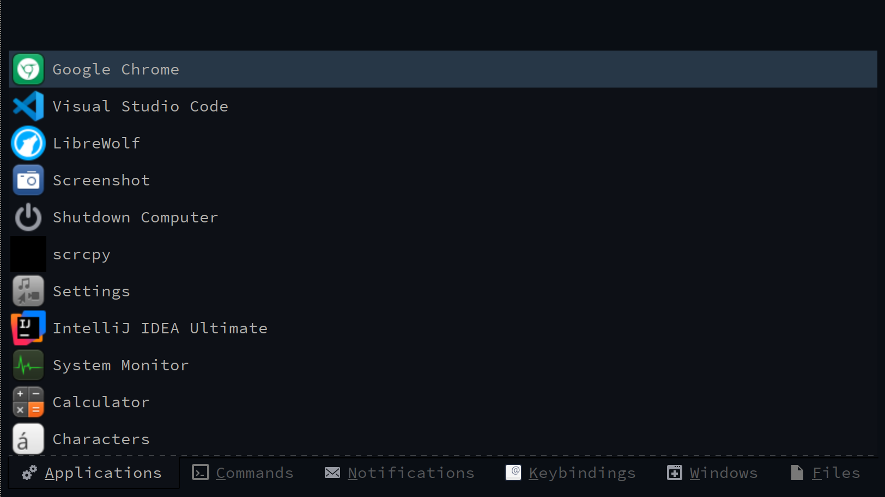

# Ilia - A Desktop Executor

Ilia is a tool for users to invoke actions such as launching apps, viewing notifications, and finding windows.
It provides a modal interface consisting of a filter box, and a list of matching items.
There are a set pages that can be selected from by specifying the desired page via a command-line parameter or by tab if all pages are loaded (controlled by command-line parameter).



## Features

Ilia provides pages to view and select from the following types of things:

- Desktop Apps (`apps`)
- System Commands (`terminal`)
- Desktop Keybindings (`keybindings`)
- Notifications (`notifications`)
- Text List (`textlist`)
- File Search (`tracker`)
- Open Windows (`windows`)
- Pages defined in files: favourite apps, fixed lines, or the lines a command prints (see [Pages from files](#pages-from-files))

## Usage

Ilia can be launched from a terminal. The `-p` option allows to specify which page to present to the user.

Ex:

```
ilia -p keybindings
```

### Desktop Apps

Ilia searches the system-configured `$XDG_DATA_DIRS` with `applications` applied at the end of each path for desktop application files.
For example, if your system has `$HOME/.local/share` in the set of paths in `$XDG_DATA_DIRS`, the path `$HOME/.local/share/applications/` will be searched for desktop app files.

### Text List

The `textlist` page is a bit different than the others pages.
It provides a general purpose utility to provide a list of options for the user select and when the selection occurs, the selected item is returned by the invocation to `ilia`.
In this way the program can be used in scripts to get user input from dynamic data, similar to `rofi`.
The `textlist` page supports two additional parameters for more customization:

```
'textlist' - select an item from a specified list
        -l: page label
        -i: page icon
```

### Pages from files

More pages can be defined in key files, without changing Ilia: a file `<name>.page` in the `ilia/pages` directory of an XDG configuration directory.
The directories are `$XDG_CONFIG_HOME/ilia/pages` (`~/.config/ilia/pages`), then `ilia/pages` in each directory of `$XDG_CONFIG_DIRS` (`/etc/xdg/ilia/pages`).
When several files define the same page, the first one found is used: the user's file hides the shared ones.
`<name>` may hold ASCII letters, digits, `-` and `_`, and cannot be the name of a built-in page; names are matched without regard to case.
A page is opened with `ilia -p <name>`, and `ilia -a` shows the pages from files after the built-in ones, ordered by file name.

```
[Ilia Page]
Name=Favourites
Icon=starred
Key=v
Apps=org.gnome.Nautilus.desktop;firefox.desktop;org.gnome.Terminal.desktop
```

```
[Ilia Page]
Name=Hosts
Icon=network-server
Key=h
ItemsCommand=awk '/^Host / && $2 !~ /[*?]/ { print $2 }' ~/.ssh/config
Exec=x-terminal-emulator -e ssh %s
Sort=frequency
OnlyShowIn=i3;sway
```

The keys of the `[Ilia Page]` group:

- `Name` (required): the label of the page's tab, as plain text.
- `Icon`: the icon of the tab and of the rows (`applications-other` by default).
- `Key`: a letter that selects the page with Alt when all pages are shown; a letter another page already uses is ignored.
- Exactly one of:
  - `Apps`: desktop file IDs, listed in the order given. Choosing one launches it as the Applications page does; entries that are not installed or not shown on this desktop are left out.
  - `Items`: lines of text, separated by `;`.
  - `ItemsCommand`: a shell command, each line it prints is a row. It runs when the page is first shown, rows appear as they are printed, and it is stopped when Ilia closes.
- `Exec`: for `Items` and `ItemsCommand`, the command that choosing a row runs, with each `%s` replaced by the row's value as one argument (`%%` is a `%`; without `%s` the value is added as the last argument). The command is not run by a shell. Without `Exec`, the value is printed, as with `textlist`.
- `Sort=frequency`: for `Items` and `ItemsCommand`, the rows chosen most often come first. Choices are recorded as `<name>#<value>` in the `app-launch-counts` setting, the launch history the Applications page ranks by, which keeps the latest 32 launches.
- `OnlyShowIn`, `NotShowIn`: window managers the page is or is not shown under: `i3`, `sway`, or `other` for any other.

A row of `Items` or `ItemsCommand` may be `label<tab>value`: the label is shown and searched, and choosing the row uses the value (in a key file, a tab is written `\t`).
Rows are matched as on the other pages, following the `fuzzy-matching` setting; rows of `Apps` are matched as on the Applications page, following `match-fields` too, but keep their order.
Files that cannot be used are reported on standard error and skipped.

The `keybindings` and `windows` pages need i3 or sway: under other window managers they are not shown, and `ilia -p keybindings` exits with an error.

## Configuration

Ilia supports the following configuration via gsettings under the namespace `org.regolith-linux.ilia`:

- window-width: width of window in pixels
- window-height: height of window in pixels
- icon-size: size of icons in pixels or 0 to disable icons
- fuzzy-matching: also show rows whose main text holds the typed letters in order, with other letters between them (off by default); such rows are listed after the other matches
- match-fields: the fields of an application, besides its name, that the filter looks in: any of `generic-name`, `keywords` and `comment` (all three by default)
- hidden-apps: desktop file ids of applications never listed on the Applications page; `*` and `?` work as wildcards. Ctrl+Delete on the Applications page adds the highlighted application

When text is typed on the Applications page, the best name matches come first: the name equal to the text, then names starting with it, names with a word starting with each typed word, names containing each word, then matches through the generic name, and then through keywords or the comment. Within each group, more frequently launched applications come first. On every page, matching ignores case and accents: `cafe` finds `Café` and `strasse` finds `Straße`.

### Example: Resetting screen width

```
gsettings reset org.regolith-linux.ilia window-width
```

## Dependencies

### Notifications

This page communicates with the [Rofication](https://github.com/regolith-linux/regolith-rofication) daemon for managing desktop notifications.

### Keybindings

This page uses the comment format specified by [Remontoire](https://github.com/regolith-linux/remontoire) and reads the i3 config via it's local socket.

## Build

Ilia uses `meson` and `ninja` to build:

```shell
git clone https://github.com/regolith-linux/ilia.git
mkdir ilia/build
cd ilia/build
meson ..
ninja
src/ilia
```

By default, Ilia builds with release optimizations. For debug builds:

```shell
meson setup builddebug --buildtype=debug
ninja -C builddebug
```

## Lint

In a build dir run this to execute `uncrustify`:

    ninja fixstyle

## Test

Run the unit tests in a build dir with:

    ninja test

For manual testing, it is useful to run with throttled CPU in debug mode, run ilia like this:

    systemd-run --pipe --user --property=CPUQuota=10% --property=MemoryLimit=100M --property=MemorySwapMax=0 --property=RuntimeMaxSec=30 --collect --wait -E G_MESSAGES_DEBUG=all build/src/ilia -p apps

Otherwise, you won't be able to see the effects of any async issues, which only reveal themselves under heavy load.

You can always run `ilia` in debug mode by editing `~/.config/regolith3/Xresources`

    # In ~/.config/regolith3/Xresources
    # Make this file if it doesn't exist.
    # Use MOD + shift + r to reload Regolith to pick up the change
    wm.program.launcher.app: G_MESSAGES_DEBUG=all ilia -p apps

And then use:

    journalctl --user --follow | grep ilia

To see any debug messages from your session.

## Package

Debian packages for Debian and Ubuntu are available in the [Regolith package repository](https://github.com/regolith-linux/voulage).
