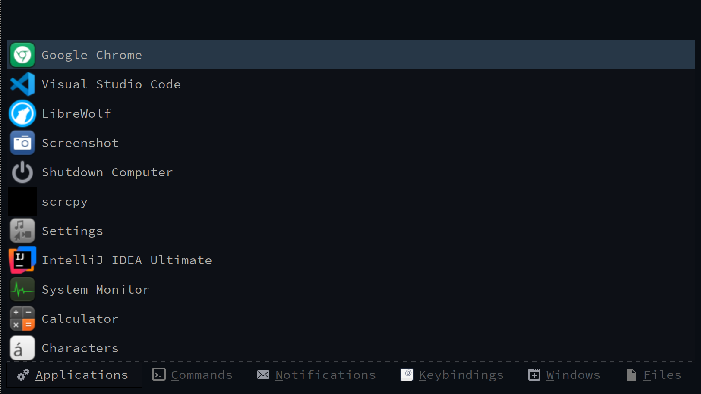

# Ilia - A Desktop Executor

Ilia is a tool for users to invoke actions such as launching apps, viewing notifications, and finding windows.
It provides a modal interface consisting of a filter box, and a list of matching items.
There are a set pages that can be selected from by specifying the desired page via a command-line parameter or by tab if all pages are loaded (controlled by command-line parameter).



## Features

Ilia provides pages to view and select from the following types of things:

- Desktop Apps (`apps`)
- System Commands (`terminal`)
- Desktop Keybindings (`keybindings`)
- Notifications (`notifications`)
- Text List (`textlist`)
- File Search (`tracker`)
- Open Windows (`windows`)
- Wi-Fi Networks (`wifi`)
- Bluetooth Devices (`bluetooth`)
- Power Profiles (`power`)

## Usage

Ilia can be launched from a terminal. The `-p` option allows to specify which page to present to the user.

Ex:

```
ilia -p keybindings
```

### Desktop Apps

Ilia searches the system-configured `$XDG_DATA_DIRS` with `applications` applied at the end of each path for desktop application files.
For example, if your system has `$HOME/.local/share` in the set of paths in `$XDG_DATA_DIRS`, the path `$HOME/.local/share/applications/` will be searched for desktop app files.

### Text List

The `textlist` page is a bit different than the others pages.
It provides a general purpose utility to provide a list of options for the user select and when the selection occurs, the selected item is returned by the invocation to `ilia`.
In this way the program can be used in scripts to get user input from dynamic data, similar to `rofi`.
The `textlist` page supports two additional parameters for more customization:

```
'textlist' - select an item from a specified list
        -l: page label
        -i: page icon
```

### Wi-Fi, Bluetooth and Power

The `wifi`, `bluetooth` and `power` pages are quick panels for the system services behind them, reached on the system bus. Each is shown on its own with `-p` (it is not one of the pages `-a` shows) and lists one row per network, device or profile, with a detail and a state. The window opens at once and the rows fill in as the service answers; they follow changes while the page is open. Enter acts on the highlighted row and closes ilia once the service accepts; if the service returns an error, or no reply within five seconds, ilia prints `ilia: <row>: <message>` on standard error and stays open.

- `wifi` (NetworkManager) lists the networks the Wi-Fi devices see, connected ones first, then by signal strength. Enter disconnects a connected network, activates a saved one, joins an open one, and asks for the password of a WPA/WPA3 personal network (Escape leaves the prompt). Enterprise (802.1X) networks are listed but not joined from here.
- `bluetooth` (BlueZ) lists paired, connected and named devices, with their battery level when known. Enter disconnects a connected device, connects a paired one, and pairs, trusts and connects any other. Discovery runs while the page is open, on the adapters that were not already discovering.
- `power` (power-profiles-daemon, at `org.freedesktop.UPower.PowerProfiles` or the older `net.hadess.PowerProfiles`) lists the profiles and marks the active one. Enter makes the highlighted profile active.

When a service is missing, or its radio is off, the page says so in a single row; Enter on the "is off" row turns the Wi-Fi radio or the Bluetooth adapters on.

## Configuration

Ilia supports the following configuration via gsettings under the namespace `org.regolith-linux.ilia`:

- window-width: width of window in pixels
- window-height: height of window in pixels
- icon-size: size of icons in pixels or 0 to disable icons
- fuzzy-matching: also show rows whose main text holds the typed letters in order, with other letters between them (off by default); such rows are listed after the other matches
- match-fields: the fields of an application, besides its name, that the filter looks in: any of `generic-name`, `keywords` and `comment` (all three by default)
- hidden-apps: desktop file ids of applications never listed on the Applications page; `*` and `?` work as wildcards. Ctrl+Delete on the Applications page adds the highlighted application

When text is typed on the Applications page, the best name matches come first: the name equal to the text, then names starting with it, names with a word starting with each typed word, names containing each word, then matches through the generic name, and then through keywords or the comment. Within each group, more frequently launched applications come first. On every page, matching ignores case and accents: `cafe` finds `Café` and `strasse` finds `Straße`.

### Example: Resetting screen width

```
gsettings reset org.regolith-linux.ilia window-width
```

## Dependencies

### Notifications

This page communicates with the [Rofication](https://github.com/regolith-linux/regolith-rofication) daemon for managing desktop notifications.

### Keybindings

This page uses the comment format specified by [Remontoire](https://github.com/regolith-linux/remontoire) and reads the i3 config via it's local socket.

## Build

Ilia uses `meson` and `ninja` to build:

```shell
git clone https://github.com/regolith-linux/ilia.git
mkdir ilia/build
cd ilia/build
meson ..
ninja
src/ilia
```

By default, Ilia builds with release optimizations. For debug builds:

```shell
meson setup builddebug --buildtype=debug
ninja -C builddebug
```

## Lint

In a build dir run this to execute `uncrustify`:

    ninja fixstyle

## Test

Run the unit tests in a build dir with:

    ninja test

For manual testing, it is useful to run with throttled CPU in debug mode, run ilia like this:

    systemd-run --pipe --user --property=CPUQuota=10% --property=MemoryLimit=100M --property=MemorySwapMax=0 --property=RuntimeMaxSec=30 --collect --wait -E G_MESSAGES_DEBUG=all build/src/ilia -p apps

Otherwise, you won't be able to see the effects of any async issues, which only reveal themselves under heavy load.

You can always run `ilia` in debug mode by editing `~/.config/regolith3/Xresources`

    # In ~/.config/regolith3/Xresources
    # Make this file if it doesn't exist.
    # Use MOD + shift + r to reload Regolith to pick up the change
    wm.program.launcher.app: G_MESSAGES_DEBUG=all ilia -p apps

And then use:

    journalctl --user --follow | grep ilia

To see any debug messages from your session.

## Package

Debian packages for Debian and Ubuntu are available in the [Regolith package repository](https://github.com/regolith-linux/voulage).
